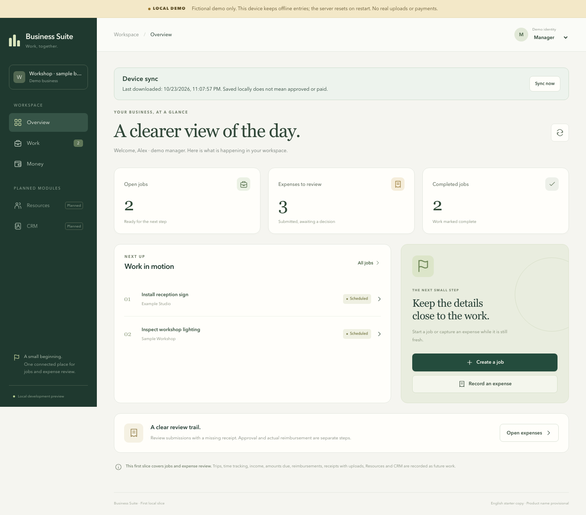

# Business Suite — working name

One modular application for small business operations: optional CRM, Work, Resources and Money. A business enables what it needs; each person sees and can act on only what their permissions allow. The intended product replaces the separate CRM and CocinaCostos projects. **The client foundation and development backend are implemented; this is not yet a replacement ready for business data.**

## Development backend

On 2026-10-24, `NOTE-010` added Business Suite to the existing Docker host: an independent `business_suite` PostgreSQL database and Auth service, plus the authenticated Fastify API. The API uses a restricted database login; it does not expose Suite tables through PostgREST. Existing app databases and services are preserved.

- API base: `https://api-dev.fabiel.org/apps/business_suite/api/v1`
- Auth base: `https://api-dev.fabiel.org/apps/business_suite/auth/v1`
- [API health](https://api-dev.fabiel.org/apps/business_suite/api/healthz): verified HTTP 200 with `demo:false`; health is process liveness, not a complete user flow.

**Client sign-in and live synchronization are still unfinished.** Browser/mobile/desktop clients continue to use their explicit fictional demo or setup screen. Deployment does not connect those clients automatically or migrate CRM/CocinaCostos data. Signup and external providers are disabled. The Mac must remain running for this development endpoint to work.

Read [shared-host operations](docs/shared-backend.md), [container construction](docs/container.md), and [database boundaries](db/README.md) before changing the deployment. Nine real-PostgreSQL verification groups passed against a separate disposable database; live Auth and client evidence is recorded separately in [verification](docs/verification.md).

## Offline-first, multiple platforms

**Human direction updated 2026-10-24:** offline operation, Android/iOS and installable Windows/macOS apps are current requirements, alongside browser access. This supersedes the earlier web-first/native-later assumption.

- **Android and iOS:** `apps/mobile`, React Native with Expo and SQLite. Native application source, not a webview wrapper. Current demo targets simulators; real sign-in and physical-device use are not ready.
- **Windows and macOS:** `apps/desktop`, Electron with locally bundled screens, persistent IndexedDB and a restricted API bridge. Separate setup and fictional-demo artifacts.
- **Browser:** `apps/web`, React with IndexedDB and a service worker that saves the built application shell for offline reopening.
- **Shared behavior:** `packages/core` and `packages/offline`; the same typed commands and sync rules, with platform-specific storage and interfaces.
- **Server:** Fastify/PostgreSQL remains the authority for permissions, accepted changes and business balances.

The current offline slice supports previously downloaded work, job-completion requests and missing-receipt expense capture. Saved entries survive app/page reopening and retry with the same command key. Pending entries, conflicts and server-confirmed records remain distinct. Job creation and expense review are online-only in the browser for now. Full receipt/time/trip/money offline flows remain on the roadmap. Desktop installation/runtime evidence is recorded separately for each OS in the verification record.

See [the offline contract](docs/offline-contract.md), [native setup](apps/mobile/README.md), [desktop setup](apps/desktop/README.md), and [verification](docs/verification.md). The current client workflows use fictional demo data; do not enter real business data.

## Requirements and agent entry point

Read [AGENTS.md](AGENTS.md), [initial implementation contract](docs/implementation-contract.md), and the [interview evidence snapshot](docs/interview-snapshot.json).

Canonical product specifications are in the iCloud Obsidian vault:

`/Users/fabiel/Library/Mobile Documents/iCloud~md~obsidian/Documents/obnotes/business-suite/business-suite hub.md`

Initial foundation: `NOTE-007`. Offline/native continuation: `NOTE-008 Offline first and native clients`. Windows/macOS extension: `NOTE-009 Windows and macOS desktop apps`. Shared backend and source publication: `NOTE-010 Deploy Business Suite backend and publish repository`. Requirements distinguish user-confirmed behavior, engineering defaults and open decisions. Snapshot status describes the interview at capture time, not current implementation progress. For handoff from another computer, read the [portable requirements snapshot](docs/requirements/README.md), [implemented source map](docs/source-map.md) and [verification record](docs/verification.md).

## Local demo

Use Node **22.13+ within Node22**, or a supported newer even release (24.3+ or26+). `.nvmrc` selects22. The host's Node25 is outside Expo58's supported range; checks were also run with Node22.23.4.

```sh
npm ci
npm run demo:offline
```

Open `http://127.0.0.1:5178` once while online, let it load, then disconnect and reload. This serves the built app with its offline shell and an isolated fictional API on4310. To work on UI with hot reload use `npm run demo`; Vite development mode does not prepare the offline shell.

For the native client, keep the demo API running and use a second terminal:

```sh
npm run mobile:demo
```

Follow [native setup](apps/mobile/README.md) for an iOS simulator or Android emulator (`adb reverse` is required for Android loopback). Real accounts, physical devices and deployed connections remain setup-only. Production builds never silently enable demo identity.

For the desktop demo, keep the API running and run `npm run desktop:demo` in another terminal. `npm run desktop` builds the setup-only variant. Desktop screens are bundled; a browser/Vite server is unnecessary. Package commands are `npm run package:desktop:mac` and `npm run package:desktop:win`; append `:demo` for fictional-demo artifacts. A standalone Windows ZIP is available through `package:desktop:win:zip:demo`; this ARM Mac could not execute the NSIS compiler. See the desktop README for profile persistence and exact local-demo limits.

The local demo API is ephemeral and resets on restart; device storage persists. A demo-session guard prevents replay into a restarted server. Inspect any saved entries before using the clearly warned local-demo reset. The deployed real API uses persistent PostgreSQL and does not share demo records or identities. No real uploads or payments are available.

## Check the foundation

```sh
npm run check
npm test
npm run build
npm run build:demo
npx playwright install chromium
npm run test:e2e
npm run test:offline
npm run build:mobile
```

Latest checks and their exact limits are in [verification](docs/verification.md). [Real PostgreSQL checks](tests/postgres/README.md) cover retry races, permissions and isolation in a disposable database. Auth-provider execution, device runtime and legacy migration are separate evidence. Native bundle export is not an installable signed app or an App Store/Play release.

## Code map

- `apps/web`: responsive React + Vite application, IndexedDB adapter and offline build shell.
- `apps/desktop`: Windows/macOS Electron shell, bundled renderer, restricted transport and packaging.
- `apps/mobile`: Expo/React Native Android+iOS application and SQLite adapter.
- `packages/offline`: shared durable queue, identity binding, conflict and retry rules.
- `apps/api`: Fastify command/query API, authentication, demo bootstrap and tests.
- `packages/core`: shared domain and permissions.
- `db/migrations`: PostgreSQL schema.
- `Dockerfile`: production-dependency API image with explicit migration entry point.
- `ops`: reviewed shared-host generator adapter and scoped deployment procedure.
- `docs`: implementation contracts, interview provenance, operational instructions and handoff.
- `tests/e2e`: browser checks for the connected local demo.
- `tests/postgres`: opt-in, disposable real-PostgreSQL integration checks.

This is a modular monolith: one product, one business database boundary, internal module ownership. Clients call authorized APIs; they never receive database credentials. Web and native clients use the same command APIs; no client receives database credentials.

## Preview

These screenshots contain fictional local-demo data.



[Phone overview](docs/preview/phone-overview.png) · [Phone expense form](docs/preview/phone-expense.png) · [Offline queue](docs/preview/offline-phone.png) · [Mac app after offline restart](docs/preview/native-desktop-offline.png)

## Scope still to build

The full product includes receipts, customer deposits/partial payments and balances, grouped/partial worker reimbursements, quotes, job/visit management, timer/manual hours, trips, allocations, lightweight CRM, private attachments and professional-service integrations. Early slices do not remove any of those requirements. See the requirements and development queue for dependencies, open questions and migration gates.

## License and contributions

Copyright (C) 2026 Fabiel ([@fabielone](https://github.com/fabielone)).

The [repository is public](https://github.com/fabielone/business-suite). Business Suite is licensed under **GNU AGPL version 3 only**
(`AGPL-3.0-only`). See [LICENSE](LICENSE) for the complete terms and
[LICENSING.md](LICENSING.md) for attribution, source-sharing and dependency
boundaries. This OSI-approved copyleft license permits commercial use and forks;
covered distributions and modified versions offered over a network must meet its
corresponding-source requirements. Preserve the required copyright and license
notices.

Fabiel is the sole maintainer of the official
[repository](https://github.com/fabielone/business-suite), with control over its
merges, roadmap and releases. Forks and pull requests are welcome: read
[CONTRIBUTING.md](CONTRIBUTING.md). Contributors retain rights to their own work;
maintainership does not imply control of independent compliant forks.

The product name remains provisional. Local/live backend checks pass; hosted CI
has a recorded startup failure before jobs run (see [verification](docs/verification.md)).
`private: true` in the npm manifests prevents accidental npm publication and is
independent of GitHub visibility. Source publication is not a production or app
store release.
