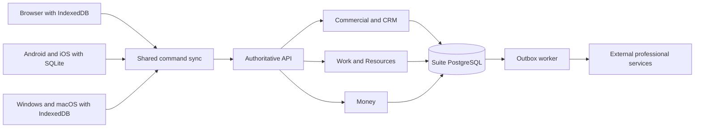

# Business Suite architecture

← [business-suite hub](<business-suite hub.md>) · [business-suite data model](<business-suite data model.md>) · [business-suite API and integrations](<business-suite API and integrations.md>)

Build one custom application with trusted modules and role-specific views. Reuse commodity infrastructure and libraries rather than rebuilding databases or identity primitives. The human selected greenfield product development, not ERP adoption. Greenfield gives control over product scope and interactions while taking on correctness, migrations, permissions and maintenance; no measured speed or scale advantage is claimed.

## Offline-first native direction
The human's later NOTE-008 instruction supersedes web-first/native-later. Offline-first and multiplatform delivery are required now. The 2026-10-24 human answer explicitly includes Windows/macOS desktop apps alongside Android/iOS/browser. Clients use React Native/SQLite on mobile, browser IndexedDB with a shell service worker, and Electron desktop with bundled React UI plus persistent-profile IndexedDB, sharing `@suite/offline` command semantics. [business-suite offline and multiplatform](<business-suite offline and multiplatform.md>) defines the bounded implementation and primary documentation sources.

Local storage owns the durable unsent intent and a last-authorized read snapshot; the server owns accepted shared business facts and all consequential permission/version decisions. These are not two independent financial ledgers. The initial client keeps queued intent separate from confirmed snapshots, so pending expense capture never looks approved/paid and pending closure never silently changes authoritative job state. A client command outbox is distinct from a future server integration outbox.

## Current evidence and proposed destination
The new local repository is [Desktop business-suite](/Users/fabiel/Desktop/business-suite). Its initial contract selects React/Vite, Fastify/TypeScript, shared domain helpers and PostgreSQL migration files. The coordinating agent reported Git initialization and installed packages while implementation was in progress. That report is not this agent's code audit or a production-readiness finding. Actual implemented paths and checks belong in [business-suite roadmap](<business-suite roadmap.md>).

Earlier vault notes describe GoTrue, PostgREST, Caddy and Docker API/worker conventions. Those notes are context, not proof of a currently running suite service. Salad-specific Node/PostgreSQL details are a precedent to evaluate, not a portfolio-wide mandate. Vercel is the chosen presentation direction; a backend API owns authoritative business commands. PostgreSQL in Docker and a later VPS remain deployment direction, not deployment already performed. Local Docker unavailability recorded by NOTE-007 must not be hidden behind PGlite success.

The proposed new suite can share one business database and auth issuer across its modules. Existing unrelated applications retain their database/auth boundaries. CRM/CocinaCostos migration and the final suite issuer/database adoption require explicit cutover; neither new docs nor demo fixtures perform that change. See [business-suite migration](<business-suite migration.md>).

## Layers have different responsibilities
| Layer | Responsibility | Boundary |
|---|---|---|
| Kernel | Business scope, identity references, money/unit primitives, command/audit/idempotency conventions | Small shared foundations, not every business record |
| Capability modules | Commercial/CRM, Work, Resources, Money and later supply functions | One owner for each invariant and command |
| Industry packs | Curated defaults, typed extensions, templates and optional capabilities | Configuration over trusted modules |
| Workspaces/screens | User-oriented views such as Customers, Operations, Money | Navigation does not grant permission |
| Connectors | Professional services, files, payments and legacy integration | Explicit API, authority and recovery contract |

A modular monolith means internally separated modules deployed together initially. It avoids distributed transaction overhead while preserving ownership. Publishing domain events does not require microservices, event sourcing or a message broker. Static first-party modules are sufficient initially; arbitrary tenant executable plugins are not approved or safely sandboxed by default.

This is a target logical diagram, not an inventory of deployed components. Module activation determines available capability; role permissions determine who may use it. A hidden screen alone is neither isolation nor disablement.

## Ownership and invariants
Commercial/Orders owns quotes, acceptance and agreed commercial revisions. Work owns executable jobs, allocation, assignment and fulfillment. Money owns obligations, receipt/payment records and their allocation; it can display commercial source amounts without owning a second independently editable selling price. Resources owns people/vehicle/equipment availability facts; costing or payroll interpretation is a separate concern.

Use one authoritative implementation per command. The proposed default is an API-owned PostgreSQL transaction on one connection, with scoped restricted credentials, validation, authorization, state/version checks, durable result/audit and eventual external delivery records. The UI cannot patch tables to bypass rules. SQL constraints and tested row security reinforce invariants rather than replace domain commands.

Do not unify order/job/invoice/payment into one object. Keep narrow typed records and explicit relations, as specified in [business-suite data model](<business-suite data model.md>). A future custom field may extend context, but cannot redefine business scope, approved amount, fulfillment quantity or financial balance calculations.

## Architecture decision register
| ID | Decision and status | Rationale or remaining boundary |
|---|---|---|
| BS-ADR-001 | One custom modular app — confirmed human direction | Modules and views, not separately synchronized apps |
| BS-ADR-002 | Reuse mature infrastructure — proposed implementation approach | Greenfield business rules do not require new database/auth primitives |
| BS-ADR-003 | React/Vite + Fastify/TypeScript workspaces — E1 engineering default | Initial implementation contract; verify actual versions in repo |
| BS-ADR-004 | Integer MXN centavos — E1 engineering default | Exact settled amounts; supersedes earlier illustrative decimal-string API for this slice; wider currency policy open |
| BS-ADR-005 | Separate explicit demo and real API modes — E1 engineering default | No auth-failure fallback or role-header privilege in real mode |
| BS-ADR-006 | Commercial, Work and Money own different facts — proposed domain design | Initial direct job price is a temporary bounded interface, not complete commercial model |
| BS-ADR-007 | One local transaction per consequential command — proposed required correctness design | Verify implementation and concurrency separately from declaration |
| BS-ADR-008 | External professional accounting/payroll/fiscal authority — proposed design for confirmed integration need | Exact providers and posting contracts unresolved |
| BS-ADR-009 | One future suite DB/auth boundary — proposed adoption | Separate from existing app boundaries; explicit migration/cutover required |
| BS-ADR-010 | Trusted modules and versioned packs — proposed later architecture | No general plugin marketplace or workflow engine in first slice |
| BS-ADR-011 | Preserve all confirmed areas while sequencing delivery — confirmed scope principle | E1 is a foundation, not cancellation of money/time/trips/resources/CRM |
| BS-ADR-012 | Offline-first multiplatform delivery — confirmed NOTE-008/009 direction | Supersedes web-first/native-later; Windows/macOS inclusion explicitly resolved |
| BS-ADR-013 | SQLite native, IndexedDB browser, shared durable command outbox — NOTE-008 engineering proposal | Keep server validation and confirmed snapshots separate from pending intent |
| BS-ADR-014 | Two-command demo allowlist with explicit conflicts — bounded initial slice | Expense submit/job close queued; create/review online; full offline coverage and live privacy pending |
| BS-ADR-015 | Electron desktop with bundled suite origin and persistent IndexedDB — NOTE-009 engineering choice | Reuse React/shared sync; isolated renderer, narrow main-process transport; release matrix/signing pending |

New decisions record date, human/engineering provenance, alternatives considered, affected requirements, migration implications and verification. Exact software license is unresolved; open-source intent is not a legal compatibility conclusion about reused code.

## Configuration and module lifecycle
Install/deploy makes trusted code available; business activation enables its capability; role navigation decides how permitted work appears. Defaults need provenance and explicit per-business overrides so a pack update cannot silently reprice work, change permissions or invalidate history. Custom fields and templates need schema versions and migration validation.

Hiding a module removes navigation only. Retirement should prevent new commitments while permitting completion, collection, refunds, recovery, audits and contract closeout. Disablement must refuse unsafe pending obligations or supply a supported closeout path. Uninstall must not drop historical records by default. Exact lifecycle policies are later requirements, not current E1 screens.

## Growth without an enterprise claim
Growth includes transaction volume, business/entity/site structure, permission/control depth, availability, recovery and offline operation. These need separate measured acceptance criteria. A five-person demo, two industry pilots or a multi-entity mock-up cannot establish enterprise readiness. Start with tested tenant/record/field isolation, traceable commands, safe migrations and recoverable data; activate deeper scheduling, approvals, inventory and integrations when their workflows are specified.

Avoid microservices, Kafka, Kubernetes, event sourcing, a full workflow builder, arbitrary plugins and a homegrown statutory payroll/tax/general ledger until a demonstrated requirement justifies them. Retain the extension path without making the first worker learn all the future concepts.

## Desktop shell and trust boundary
The desktop application bundles its React assets and serves only them from controlled `suite://app/`, without requiring a web server for shell launch. Use an isolated sandboxed renderer and a narrow preload/main-process bridge. Initial demo transport is fixed to the loopback API; main-process argument/sender validation and backend business authorization are both required. A desktop main process is not permission to expose arbitrary URLs, files, commands or database credentials.

Persistent app-profile IndexedDB is distinct from browser-origin IndexedDB and mobile SQLite. An update or name/profile change must preserve or deliberately migrate unsynced work. Live/setup has no demo fallback. [business-suite desktop applications](<business-suite desktop applications.md>) supplies lifecycle, source references and release-evidence distinctions; actual NOTE-009 implementation is recorded separately from this engineering choice.

## NOTE-009 implemented desktop boundary
The local Electron 45/electron-builder 26.18 foundation is implemented and tested on macOS 27.0.1 arm64. The inspected desktop README records persistent setup/demo profiles, a sandboxed renderer with frozen `platform/mode/request` bridge, bundled `suite://app/` shell and fixed loopback transport. Three staged-app runtime tests and a separate packaged-Mac shell smoke passed; Windows x64 ZIP packaging passed but Windows runtime and NSIS installer success did not. These findings validate the bounded host/client cases, not the full target architecture or production privacy/release controls. [business-suite roadmap](<business-suite roadmap.md#note-009-desktop-foundation--2026-10-24>)
