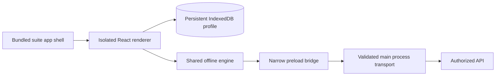

# Business Suite desktop applications

← [business-suite hub](<business-suite hub.md>) · [business-suite offline and multiplatform](<business-suite offline and multiplatform.md>) · [business-suite architecture](<business-suite architecture.md>)

## Confirmed scope and evidence boundary
The human explicitly requested **Windows and macOS desktop apps now** on 2026-10-24. Both are current delivery requirements alongside Android, iOS and browser access. Desktop is no longer an unanswered priority or contingent on finishing the web product. Linux desktop is not added by this answer. NOTE-009 (Obsidian reference) owns the current execution checklist.

Electron is the engineering choice for packaged desktop applications reusing the React interface and `@suite/offline`. React Native with SQLite remains the mobile implementation; the desktop choice does not replace it. Electron provides a desktop runtime using web UI technology; it is not a claim of a separately rewritten native-widget interface.

NOTE-009's initial desktop slice shares the same supported offline intents: missing-receipt expense submission and job closure. Creation and review/approval remain online where available. The other required business workflows remain planned work. Real authentication and local-data privacy are incomplete, so only fictional demo data is appropriate. A packaged executable is not proof of the full product, secure storage, signing, notarization or runtime correctness on the other operating system.

## Bundled interface and application boundary
Bundle the built React shell and assets inside the desktop application. Serve them through the controlled `suite://app/` origin rather than a running development web server. Launching the shell should work without Vite, an internet connection or a reachable API. A new device still needs authorized online preparation before it has real/cached business records; an empty local store must show that distinction.

A custom protocol is an Electron mechanism, not a network server or a grant of business authority. Register only required privileges, including standard/secure behavior for the intended local origin. Electron documents that nonstandard schemes restrict web storage and that a handler belongs to a specific session, which must match the application window. Do not enable CSP bypass merely because a documentation example shows it. [Electron protocol API](https://www.electronjs.org/docs/latest/api/protocol)

Validate allowed scheme/host/path and constrain asset resolution to the packaged application directory. Reject traversal, unsupported requests and unintended network destinations. The desktop shell does not package the authoritative business database merely by containing the UI. An API is still required for synchronization; a missing API produces offline/pending or setup state rather than a fake acknowledgement.

This is the chosen architecture. The inspected desktop README and coordinating agent's results below now identify the implemented source/bridge/profile contract; release and wider lifecycle verification remain separate.

## Renderer and API bridge
Keep Node integration unavailable to the renderer, enable context isolation and sandboxing, apply a restrictive content security policy, and restrict navigation/new windows. A preload bridge exposes only the small application API needed by the UI; it must not expose raw IPC, arbitrary filesystem access, shell execution or an unrestricted URL fetcher. Main-process IPC validates the sending frame/origin and every argument. These choices follow Electron's guidance on isolation, sender validation and limiting exposed APIs; they are requirements to verify in this application. [Electron security guidance](https://www.electronjs.org/docs/latest/tutorial/security)

The initial demo main-process transport is fixed to the existing loopback demo API, `127.0.0.1:4310`, with a bounded method/path/payload contract. Do not allow a renderer-controlled URL or redirect to turn it into a general proxy. Preserve business/identity context, idempotency keys and the demo generation guard. The main process's greater OS access does not give a user new business permissions; backend authorization/version checks remain decisive.

Live/default mode must show setup requirements until real authentication and service configuration exist. It must not silently switch to the demo API on network error, missing token or failed authentication. Demo remains explicit and fictional. Do not weaken the existing API's loopback/host rules to make a package appear connected, or expose the local demo on a LAN.

## Persistent local data and application lifecycle
Use the existing IndexedDB storage adapter and shared offline semantics inside an application-controlled persistent Electron profile. This desktop profile is separate from the browser's origin storage and the mobile SQLite database. Every store still needs environment/business/actor ownership; an OS account or application profile is not a substitute for business authorization.

Electron exposes application user/session-data paths; the default user-data location depends on application identity. A later branding change must preserve or explicitly migrate the profile instead of silently making pending work disappear. The current implementation uses `Business Suite Desktop/setup` or `/demo` beneath the platform application-data directory, with `persist:suite-setup` and `persist:suite-demo` sessions. Browser/mobile stores remain separate. Upgrade/profile-migration policy is not established by these paths. [Electron application paths](https://www.electronjs.org/docs/latest/api/app#appgetpathname)

Saving a supported command must complete its local transaction before “saved on this device.” Confirmed snapshots stay separate from pending intent. Quit, ordinary app restart and package replacement must not clear pending commands. The generation guard still prevents an old queue from replaying into reset ephemeral demo fixtures. To test reconnect success, interrupt transport while retaining the same API generation; test API restart locking separately.

Local persistence is not encryption or a backup. Disk failure, user profile deletion, device loss and external cleanup can still lose unsynchronized work. Protect live credentials, queued payloads, attachments, diagnostics and recovery exports under an explicit policy before real-data use. Do not label a profile secure merely because the renderer is sandboxed.

## Installation update and removal contract
| Lifecycle event | Required/proposed behavior | Evidence still needed |
|---|---|---|
| First install/launch | Start bundled shell without web server; distinguish prepared demo, offline empty state and live setup | Actual installed launch per OS/architecture |
| App quit/restart | Preserve committed snapshot and pending intent; retain visible sync status | Quit/relaunch and abrupt termination tests |
| Manual package update | Keep stable profile; migrate supported local schema without losing pending work | Upgrade rehearsal with queued/conflicted records |
| Automatic update | Select trusted signed release/channel and explicit recovery policy before activation | Provider, update implementation and platform tests; not implied by packaging |
| Downgrade | Reject incompatible local schema or follow a tested recovery plan | Compatibility matrix; no silent database reset |
| Uninstall | App-controlled cleanup must not silently delete unsynced work; warn and offer deliberate retention/recovery where supported | Installer/uninstaller behavior on each supported OS |
| Explicit data reset | Separate from ordinary uninstall/update; show pending-work consequences and require deliberate action | Fictional demo reset is not a live retention policy |

An installer cannot guarantee that an external OS cleanup or a person manually deleting the profile preserves data. Document the real retention behavior and recovery limits. Retaining files after uninstall also has privacy implications; settle explicit retention/purge choices rather than deleting or keeping sensitive data without explanation.

Electron supplies update mechanisms, but a working update channel requires configured distribution and application handling. No update server, automatic feed, background installer or release channel is selected or deployed by this specification. Pending work must survive supported updates regardless of the chosen mechanism. [Electron updating applications](https://www.electronjs.org/docs/latest/tutorial/updates)

## Platform release decisions
Windows and macOS inclusion is resolved. Minimum supported OS versions, x64/arm64 coverage, universal binaries, installer formats, per-user/system installation, signing identity, notarization, update channel and support policy remain open. Engineering packaging targets used during NOTE-009 are evidence of those specific builds, not approval of a broad support matrix.

Code signing identifies the publisher and is separate from merely creating a package; Electron documents signing for Windows/macOS and the macOS notarization workflow. These release steps need the selected credentials/service and actual evidence. No certificate purchase, signing-account setup or package upload follows from the local build task. [Electron code signing](https://www.electronjs.org/docs/latest/tutorial/code-signing)

Do not ask users to disable operating-system protections as the product's installation strategy. An unsigned internal artifact must be labeled as such. A generated Windows target on a Mac does not prove it launches or preserves IndexedDB on Windows. A macOS development launch does not prove an installed/notarized application, another architecture or an automatic update path.

## Verification and evidence handoff
Record separately: source inspection; static/unit tests; renderer/bridge security tests; packaged artifact produced; application launched; offline/restart/reconnect flow observed; actual OS and architecture; installer/uninstaller behavior; signing/notarization validation; and update/recovery rehearsal. Passing an earlier level does not imply later levels.

[business-suite quality and verification](<business-suite quality and verification.md>) contains desktop scenario IDs. Root should append final paths, artifacts, checks, runtime observations and unrun release checks under [business-suite roadmap](<business-suite roadmap.md#note-009-desktop-foundation--2026-10-24>). Keep NOTE-007/008 reports unchanged as history. The bounded desktop evidence is recorded below; no remote publication, live infrastructure change, legacy migration or production promise is made.

## Verified bounded implementation
On 2026-10-24 root reported all-workspace type checks and **38 aggregate unit/API tests** passing, including eight desktop bridge/security tests. **Three actual Electron runtime tests on macOS 27.0.1 arm64** pass against the staged app with Electron 45.0.0: bundled UI/renderer isolation, persisted offline intents through quit/relaunch and reconnect, and setup refusing demo/API access. The tested two intents retain their IDs/identity/API generation and produce one server effect each. This is tested idempotency, not an exactly-once delivery claim.

The implementation exposes a frozen `suiteDesktop` object with only `platform`, `mode` and `request`. The main process verifies its exact window/main frame and `suite://app/` document, allowing same-document hashes such as the repaired skip link. It accepts only bounded supported request fields/routes, connects directly to `127.0.0.1:4310/v1`, rejects redirects, and uses a ten-second deadline plus 64 KiB input/response limits. Setup denies bridge API requests even when launched with `--demo`. The renderer has no Node globals and registers no browser shell service worker because assets are already bundled. Source map and exact constraints: [desktop README](/Users/fabiel/Desktop/business-suite/apps/desktop/README.md).

The persistent app profile passed ordinary macOS quit/relaunch testing; abrupt power loss, updates, uninstall and live-data recovery are not thereby verified. Desktop live auth, encryption/retention and account lifecycle remain incomplete. Only fictional demo data is supported.

**Artifacts:** demo arm64 macOS DMG/ZIP are built, unsigned and not notarized. The Windows x64 app is packaged in `win-unpacked`; Windows x64 ZIP is built with CRC verified, and its executable is PE32+ x86-64. NSIS installer creation failed with `spawn error -86` because bundled x86_64 Mach-O `makensis` cannot execute on the ARM build host as configured. No Rosetta/system install was added. A Windows target/manual CI workflow exists but has not run; no Windows installation/runtime result is claimed. The actual packaged Mac demo `.app` launches without an API/web server and reports `isPackaged=true`, `suite://app/`, demo mode and no Node globals, showing the correct connect-once empty-offline state. This is a packaged-shell smoke test, not an installed DMG walkthrough. The DMG checksum and both ZIP CRC checks pass. All 8 connected plus 2 built-shell offline browser regressions, format check and default/demo builds pass. Five known high Expo development-toolchain findings remain release work. [business-suite roadmap](<business-suite roadmap.md#note-009-desktop-foundation--2026-10-24>) is the canonical evidence summary.
