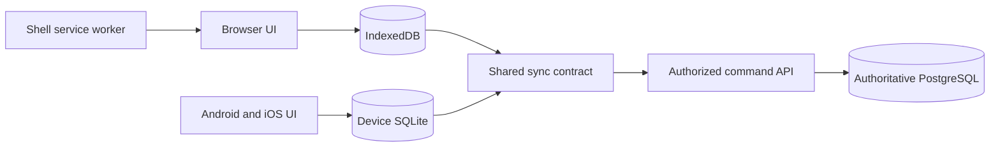

# Business Suite offline and multiplatform

← [business-suite hub](<business-suite hub.md>) · [business-suite requirements](<business-suite requirements.md>) · [business-suite architecture](<business-suite architecture.md>)

## Confirmed direction and bounded delivery
On 2026-10-23 the human required **offline-first operation because connectivity is unreliable, and multiplatform native applications rather than only a web app**. This supersedes web-first/native-later sequencing and the earlier unanswered question of whether offline support is needed. Android, iOS and browser are the current implementation assumption; native desktop platforms and priority remain unanswered. NOTE-008 (Obsidian reference) is the active authorized task.

Offline-first means supported work is saved to durable local storage before a network attempt and remains available through a connection interruption or normal client restart. It does not mean every financial action is final without server validation, every record is downloaded, or all workflows are already implemented. Local save, server acceptance, manager approval and actual payment are distinct outcomes.

The initial NOTE-008 slice queues **missing-receipt expense submission and job closure**. Job creation and expense review/approval remain online initially. Reading previously authorized cached work is included; first-time sign-in, first-time download and unavailable records need connectivity. Receipts, timers/manual time, trips, assignments, customer money and reimbursements remain full product requirements with offline behavior to be designed and implemented. This small allowlist is sequencing, not cancellation.

## Implementation proposal and evidence boundary
Use Expo React Native clients with local SQLite for Android/iOS, the existing web UI with IndexedDB plus a shell service worker, and a shared `@suite/offline` package for queue semantics. Keep platform storage and presentation adapters separate from the shared command protocol. Existing backend authorization, business rules and PostgreSQL commands remain authoritative. Do not replace the suite server with independently authoritative device balances.

Expo describes local-first applications as reading and writing locally while also noting that remote actions still need explicit queued/accepted/failed states and that synchronization and permission handling remain design work. Its SQLite library persists the database across app restarts. These mechanisms support the proposal; they do not verify this repository's implementation or device security. [Expo local-first guide](https://docs.expo.dev/guides/local-first/), [Expo SQLite](https://docs.expo.dev/versions/latest/sdk/sqlite/)

IndexedDB supplies asynchronous transactional structured storage; browser quotas and eviction differ. A service worker can cache the application shell for reopening offline, with a secure-context requirement in normal deployment. Neither automatically synchronizes business records. [MDN IndexedDB](https://developer.mozilla.org/en-US/docs/Web/API/IndexedDB_API), [MDN Service Worker API](https://developer.mozilla.org/en-US/docs/Web/API/Service_Worker_API)

No Expo version, physical-device support, app-store build, production login, encryption or full offline-product readiness is established by those documentation facts. Root records actual dependencies, commands and checks in [business-suite roadmap](<business-suite roadmap.md>). Current development uses fictional demo data only until live authentication and local-storage privacy are completed.

This is the proposed architecture. The web service worker's shell cache and the client's command outbox have different purposes. The client outbox is also distinct from a future server outbox used to deliver accounting or other external integration work.

## Local records and queue contract
A cached snapshot identifies server origin/environment, business, authenticated subject, schema version, fetch time and source versions. It contains only fields and records the server authorized for that identity. Device storage must not accidentally share one worker's cached prices or another business's expenses when users switch.

A queued intent needs a stable command ID/idempotency key, command kind, business/actor/environment scope, exact payload, expected record version when applicable, local creation time, queue schema version, attempt metadata and visible outcome. These are conceptual fields until matched against the implemented package. Tokens do not belong in queued payloads. Local timestamps describe capture; the server records receipt/commit time and does not trust the device clock for ordering or permissions.

Persist the pending intent before reporting “saved on this device.” If a local projection is also written, commit it and the intent atomically or derive the projection from the durable intent so a crash cannot leave a false completed job with no pending command. If storage fails, show unsaved status and preserve recoverable input; do not proceed as though the local guarantee succeeded.

User-facing outcomes must distinguish pending, synchronized, conflict, denial and needed recovery. The initial inspected `packages/offline/src/index.ts` uses command statuses `queued`, `conflict`, `rejected`; a successful acknowledgement removes the pending item and atomically updates the confirmed snapshot. `blockedReason` represents a locked local store. There is no optimistic financial projection or persisted generic “paid” status. A synchronized expense can still be `submitted` for manager review; it is neither approved nor reimbursed. A queued close leaves the confirmed job status unchanged until acknowledgement.

## Expense submission walkthrough
1. The worker opens a previously cached authorized workspace and job while offline. The UI shows the last successful refresh and offline/pending indicator.
2. They enter a business-only amount, description, optional known job and mandatory missing-receipt reason. Local validation catches malformed input but cannot grant authority.
3. The client creates one stable command identity and durably saves the exact intent locally. Only then does it confirm local save and show the pending item.
4. On a foreground/manual reconnect attempt, the client submits the same intent with its original idempotency key and correct identity/business context.
5. The server verifies current identity, membership, enabled capability, action and record scope; validates payer, money and job relation; and applies its existing transactional command. A queue item is not permission to bypass these checks.
6. The client persists the authoritative result and reconciles the pending projection. The expense now appears as synchronized and awaiting review. No payment occurs.
7. If the server committed but the response was lost, retry the exact command/key. A stable server result prevents a second expense. If authority is denied, stop automatic retries for that item and show the denial; do not resubmit as a new user.

## Closure conflicts and recovery
A queued close includes the job version the worker observed. Another device may edit, reassign or close the job before synchronization. The server evaluates current authorization and version. A conflict must not be auto-resolved by replacing the expected version or marking local completion as authoritative. Fetch permitted current state, explain the competing change, retain the intent safely and let an authorized person decide whether a new command is appropriate.

Financial amounts, approvals, reimbursements and allocations never use automatic last-write-wins or additive conflict merging. A corrected amount is a new deliberate intent; preserve the original outcome and a traceable replacement link where implemented. Do not change a payload under an idempotency key already used on the network.

A timeout or 5xx can mean an unknown outcome, so retry the stable key with bounded backoff. A 401 needs authentication recovery before replay. A 403 or inaccessible 404 requires stopping and refreshing permitted state, not endless retries. A 400 or unsupported schema needs correction/upgrade. A 409 can indicate record conflict or reused-key mismatch; preserve the server error code and do not treat both as harmless duplicate success. The inspected initial client keeps network/5xx/408/429 outcomes queued and stops that replay attempt; 409 becomes `conflict`, other terminal 4xx become `rejected`. A 401/403 clears the protected snapshot, sets `blockedReason` and stops replay, retaining intents in the locked store. No automatic conflict replay/rebase is provided. This is source-inspected behavior, not a completed runtime/device test.

Queue persistence and server idempotency are both needed. Foreground/manual replay is the dependable initial contract; background execution is an optimization to verify separately. Never promise that a suspended or closed app will synchronize at a particular time. Concurrency between tabs/devices needs single-queue ownership or transactional claims, while server deduplication remains the final duplicate defense.

## Session privacy and offline authority
The product needs an explicit policy for cached-data access after token expiry, account logout, device lock and membership revocation. Immediate remote revocation cannot erase a disconnected device by magic. Maximum offline access duration, lock/unlock, shared-device behavior, recovery and retention remain open decisions. Real-data use must wait for a tested policy; demo credentials and unencrypted fictional stores do not establish one.

On account/business/environment switching, isolate caches and intents and never replay one actor's operation under another identity. On known revocation, stop replay and clear or lock protected projections according to the selected policy. Handling unsent work must balance privacy with recovery and must not silently lose it or expose it to the next user. The inspected initial client requires a matching fictional `demo` workspace and `demoSessionId`, revalidates before each replay batch, and locks if pending work belongs to an earlier demo generation. Explicit reset is for fictional data and must warn about unsynced entries. It cannot demonstrate a real-user authentication/retention policy. The client refuses ordinary discard of a `queued` item because uncertain delivery may already have committed; terminal conflict/rejected items can be removed under the demo UI contract.

Native credential storage, local database/attachment protection, browser script exposure, device backups and app uninstall/data-clear loss require dedicated design. SQLite or IndexedDB alone does not certify encryption. Persist only the minimum permitted data; exclude receipts, bank details and other real sensitive content from the demo. See [business-suite security privacy and operations](<business-suite security privacy and operations.md>).

## Updates capacity and future offline flows
Version local schemas and command envelopes. An app update must preserve pending intents, either migrate them safely or block replay with an understandable recovery path. A service-worker shell update must not clear the business queue. Test upgrade with unsent work and multiple tabs; do not cache authenticated API responses in a generic public shell cache.

Browser eviction, disk capacity, local corruption, device loss and reinstall can remove unsynchronized work. Surface storage failures and last synchronization, and define practical backup/export recovery without exporting secrets or unauthorized records. Persistent local storage is not a server backup or a guarantee against device loss.

Future receipt capture needs durable local file/blob references, capacity checks, retryable uploads and a verified link from file to expense; missing upload is not equivalent to missing-receipt approval. Timers/manual time need durable start/stop facts and explicit clock/overlap correction; trips need the existing privacy and cost-allocation rules. Assignments and capacity may be stale offline. Customer payments and reimbursements need separate recorded-event, pending-validation and reconciled-balance semantics. None of these are fulfilled merely by adding generic queue methods.

## Verification and handoff
[business-suite quality and verification](<business-suite quality and verification.md>) owns scenario IDs for save-before-send, restart, cached launch, reconnect/lost response, stale close, revocation, identity isolation, capacity failure and schema upgrade. NOTE-008 owns the execution checklist. Root should append actual package/source paths, browser checks, Android/iOS build/device evidence and unrun checks in [business-suite roadmap](<business-suite roadmap.md>), preserving NOTE-007's historical results. The requirement is confirmed; platform adapters and complete native/web execution evidence await root. The shared client's mechanism above was read in source on 2026-10-23; that inspection is not a passing test, secure storage certification or complete offline product claim.

## Inspected initial shared types
`Snapshot` contains `workspace`, confirmed `jobs`, confirmed `expenses`, and `fetchedAt`. `LocalState` contains `schemaVersion: 1`, persistent nullable `owner` (business/user), nullable `snapshot`, `commands`, nullable `blockedReason` and `lastSyncAt`. `PendingCommand` contains `id`, `kind` (`expense.submit` or `job.close`), `path`, `body`, `createdAt`, `status` and optional message. Business/user scope is supplied to the client and must also scope the adapter's physical store; the current command object does not repeat all conceptual envelope metadata described above.

`LocalStore.read()` returns state; `update(change)` must atomically commit and serialize updates, including other tabs where applicable, with no network inside its callback. Unsupported schema is surfaced without overwriting the local database. `enqueue` validates cached module/grants and known job/version before saving, while the server still revalidates current authority at replay. A duplicate local close for a job returns its existing pending command. `sync` serializes calls within one client instance, refreshes authority/demo generation before replay and updates acknowledgement plus snapshot together. Adapter cross-tab/device and crash behavior need their own verification; this class alone does not prove them.

## Verified local extension
NOTE-008 2026-10-23 Offline and native foundation report (Obsidian reference) and [business-suite roadmap](<business-suite roadmap.md>) record16 shared-engine,12 API,2 native parsing,8 connected browser and2 built-shell offline tests passing. Android/iOS Hermes exports pass; native runtime remains untested. Stored intents are validated against the exact two-command allowlist before replay and during atomic updates. Five high Expo CLI dependency audit entries remain unresolved release work. Full offline coverage and live-user local security remain incomplete.
